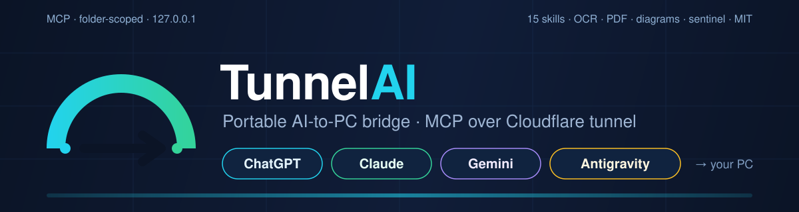

# TunnelAI — portable AI-to-PC bridge (MCP over Cloudflare tunnel)

<p align="center">
  <a href="LICENSE"></a>
  
  
  
  
  
  
</p>

<p align="center">
  
</p>

## See it in action

Video coming soon — [demo script (60 s, ready to record)](docs/DEMO-SCRIPT.md) is included so you can
make your own in one take (Win + Alt + R on Windows).

```powershell
Verificar-Entorno.cmd   # 1. diagnose
Iniciar-TunnelAI.cmd    # 2. paste a folder -> URL to clipboard
Agregar-Skill.cmd todas # 3. install the 15 skills -> ask for the audit
```

A **portable, OneDrive-friendly folder** that connects **ChatGPT, Claude, Gemini (web & mobile) and Google Antigravity** to your Windows PC through MCP (Model Context Protocol) — with or without a public tunnel.

Copies to any PC, sets itself up (Node, cloudflared), asks for a folder, and hands you a URL to paste into your AI assistant. Optionally, the AI becomes a **code auditor, web developer, OCR reader, security reviewer or documentation writer** with 15 ready-to-use skills.

**License: MIT** — see [LICENSE](LICENSE) · Copyright (c) 2026 Omar Pajares.

> ⭐ **If this saves you time, star the repo** — it helps others find it.

## Why this is more than "let the AI read my files"

- **4 assistants, one PC**: ChatGPT, Claude, Gemini (web/mobile) and Antigravity — tunneled or 100% local.
- **15 ready-to-use skills**: the AI becomes an auditor, web developer, **offline OCR reader** (invoices, scans, screenshots), project onboarding guide, dependency/secret watchdog, documenter, **package installer (npm/pip/dotnet/winget…)**, legacy-code migrator, performance profiler, WCAG accessibility auditor, data analyst, QA engineer, SEO specialist, **PDF report generator** and **architecture diagram generator** (Mermaid renders natively on GitHub).
- **Self-healing sentinel**: probes the MCP server every 20 s, detects crashes, bottlenecks and *installations in progress*, and repairs **without killing the tunnel or your processes**.
- **Stable URL option**: named Cloudflare tunnel (your domain) so the URL never changes.
- **Security first**: folder-scoped, server bound to `127.0.0.1`, optional Bearer token, cleanup that never kills global node/dotnet processes.

### Why not just copy files into the chat?

| | Copy-paste | TunnelAI |
|---|---|---|
| 500-file projects | ❌ | ✅ whole folder, folder-scoped |
| Run builds / tests / installs | ❌ | ✅ terminal with 40 s-safe timeouts |
| Re-read after each change | ❌ | ✅ the AI sees the live state |
| OCR scans & PDFs | ❌ | ✅ offline Windows OCR + local PDF export |
| Works on mobile (Gemini) | ❌ | ✅ tunneled from the phone |
| Nothing leaves the machine | — | ✅ local mode (Antigravity) + `127.0.0.1` |

## Tech stack & languages

| Layer | Technology |
|---|---|
| Automation / launchers / tools | **PowerShell** (`.ps1`, Windows PowerShell 5.1 + 7+, Win32/WinRT: `Get-CimInstance`, `Windows.Media.Ocr`, `TcpListener`) |
| Windows entry points | **Batch** (`.cmd` wrappers, double-click ready) |
| MCP servers (upstream) | **Node.js / JavaScript** — `chatgpt-local-mcp`, `expose-files-mcp` (npm, ESM), patched at runtime by TunnelAI |
| Tunnel | **cloudflared** (Go binary) — quick tunnels or named tunnels via `config.yml` |
| Protocol | **MCP** (Model Context Protocol) over Streamable HTTP (`/mcp`) |
| OCR engine | **WinRT** (`Windows.Media.Ocr`) — offline, no cloud API |
| PDF export | **Edge/Chrome headless** (`--print-to-pdf`) |
| Diagrams | **Mermaid** (`flowchart`, `sequenceDiagram`, `classDiagram`) — rendered by GitHub/GitLab |
| Config & manifests | **JSON** (`mcp_config.json`), **Markdown** (15 skills + docs) |
| Reports & templates | **HTML + CSS** (self-contained, print-oriented) |
| CI | **GitHub Actions** (PowerShell syntax + skills + tool smoke tests) |
| Requirements | Windows 10/11 · Node 18+ · git (only for forks) |

## What's inside

| File | Client / purpose | How it connects | Port |
|---|---|---|---|
| `Iniciar-TunnelAI.cmd` | **ChatGPT** | cloudflared quick tunnel → public `/mcp` URL | 3001 |
| `Iniciar-Gemini.cmd` | **Gemini** (web/mobile) | same tunnel → public `/mcp` URL | 3001 |
| `Iniciar-Claude.cmd` | **Claude** | cloudflared quick tunnel → public `/mcp` URL | 3002 |
| `Iniciar-Antigravity.cmd` | **Google Antigravity** | **local, no tunnel** → `localhost:3003/mcp` | 3003 |
| `Verificar-Entorno.cmd` | diagnostics | Node, cloudflared, packages, ports | — |
| `Limpiar-Bloqueo.cmd` | maintenance | frees 3001/3002/3003 (never kills node/dotnet globally) | — |
| `Monitor-TunnelAI.cmd` | **sentinel** | probes every 20 s and repairs without killing the tunnel | any |
| `Agregar-Skill.cmd` | **skills** | installs 15 AI roles into the exposed folder | — |
| `Config-Tunel-Estable.cmd` | advanced | named Cloudflare tunnel → **stable URL** (needs account+domain) | — |

`lib/TunnelAI.Common.psm1` holds the shared logic. `Tools/` contains the OCR engine, PDF converter and diagram generator. `.ultima_ruta.txt` remembers your last folder.

> Spanish-language scripts and console messages; English documentation, skills and code comments.

## Quick start

1. **Requirements**: Windows 10/11, **Node 18+** (https://nodejs.org). Internet needed only the first time.
2. Double-click the launcher for your assistant, paste a folder path, press Enter.
3. Copy the `/mcp` URL (it's copied to your clipboard automatically) and paste it into your assistant.
4. Optional: `Agregar-Skill.cmd` → install a skill → tell the AI *"Read TUNNELAI-SKILL-auditoria.md and run the audit on the root"*.

```powershell
Verificar-Entorno.cmd                            # diagnose your setup
Iniciar-TunnelAI.cmd -Ruta C:\Proyectos\MiApp    # non-interactive launch
Iniciar-TunnelAI.cmd -MaxMinutos 30              # auto-close the tunnel after 30 min
Agregar-Skill.cmd todas                          # install all 15 skills
```

## Using each assistant

### ChatGPT
1. Double-click `Iniciar-TunnelAI.cmd`
2. Paste the folder → Enter
3. In ChatGPT: `Settings → Connectors → Add connector → MCP` → Authentication: **No Auth** → paste the URL.

### Gemini (gemini.google.com)
1. Double-click `Iniciar-Gemini.cmd` → paste the folder → Enter
2. In Gemini: `Settings → Connected Apps → Custom apps → Add a custom app` → paste the URL
3. Requirements: **personal** Google account (not Workspace/school), **Keep Activity** on, US region.

> ChatGPT and Gemini can share the same URL at the same time — the launcher detects an active session on port 3001 and reuses it.

### Claude
1. Double-click `Iniciar-Claude.cmd` (**not** the ChatGPT one)
2. Paste the **same folder** → Enter
3. In Claude: `Customize → Connectors → Add custom connector → URL → No sign-in`

### Google Antigravity (recommended if installed on this PC)
**No tunnel, no public URL, faster.**
1. Double-click `Iniciar-Antigravity.cmd` → paste the folder → Enter
2. The launcher writes the `tunnelai` server into `C:\Users\<you>\.gemini\antigravity\mcp_config.json` by itself.
3. In Antigravity: `⋯` (agent panel) → **MCP Servers → Refresh**
4. To stop it: `Iniciar-Antigravity.ps1 -Detener`
5. Also works with **Gemini CLI**: `gemini mcp add --transport http tunnelai http://localhost:3003/mcp`

## Skills for the AI (15 ready-to-use roles)

`Agregar-Skill.cmd` installs a **role** into the exposed folder that the AI reads by itself (it shows up via `list_files`), and copies the text to your clipboard:

| Skill | What it does |
|---|---|
| 🔍 `auditoria` | Full code audit: security, quality, architecture, performance, tech debt → `AUDIT-<date>.md` |
| 🌐 `web` | Build a website in the root: structure, iteration, verification, delivery |
| 🧾 `ocr` | **OCR for images/scans/invoices** with `Tools/OCR.ps1` (Windows engine, offline) → structured text |
| 🗺️ `onboarding` | Complete map of an unfamiliar project in minutes: stack, how to run, modules, repo health |
| 🔐 `seguridad` | Vulnerable dependencies (`npm audit`, `dotnet list package --vulnerable`), exposed secrets, insecure config, licenses |
| 📚 `documentar` | Document real code into README/API docs with examples taken from the code |
| 📦 `instalacion` | **Install libraries and programs** (npm, pip, dotnet, winget, cargo…) with verify, `INSTALLED.md` log and safe timeouts |
| 🔄 `migracion` | Move legacy code to a modern stack in verifiable phases without breaking the project |
| ⚡ `rendimiento` | Measure before/after, find real bottlenecks, prioritize by impact |
| ♿ `accesibilidad` | Audit the website against WCAG 2.2 AA and fix with evidence |
| 📊 `datos` | Analyze CSV/Excel/JSON: data quality, statistics, anomalies, decision tables |
| 🧪 `testing` | Test strategy, tests that find real bugs, actionable defect reports |
| 🔎 `seo` | Technical SEO: meta tags, canonical, sitemap, JSON-LD, Core Web Vitals |
| 📄 `informes` | Reports Markdown/HTML → **PDF** with `Tools/HTML-a-PDF.ps1` (local Edge/Chrome) |
| 🏗️ `arquitectura` | **Architecture diagrams in Mermaid** (render natively on GitHub) with `Tools/Nuevo-Diagrama.ps1` |

```
Agregar-Skill.cmd                    # menu (1-15) or "All"
Agregar-Skill.cmd auditoria          # direct install
Agregar-Skill.cmd ocr C:\Proyectos\X # into another folder
Agregar-Skill.cmd -Listar            # list the catalog
Agregar-Skill.cmd -Quitar            # remove skills from the folder
```
Then tell the AI: *"Read TUNNELAI-SKILL-auditoria.md and run the audit on the root"*.

### Local tools (no external services)

**OCR** — `Tools/OCR.ps1` extracts text from images using **Windows.Media.Ocr** (offline, private, no paid API):
```
Tools/OCR.ps1 -Ruta invoice.png                  # line-by-line text
Tools/OCR.ps1 -Carpeta .\scans -Salida out.txt   # whole folder + save
Tools/OCR.ps1 -Ruta img.png -Json                # JSON with lines and words
```
It self-relaunches under Windows PowerShell 5.1 when needed (WinRT) and accepts `-Idioma es-ES`/`en-US`.
Alternative: `winget install UB-Mannheim.TesseractOCR` and it falls back to tesseract.

**PDF reports** — `Tools/HTML-a-PDF.ps1` converts any HTML report to PDF with Edge/Chrome (ships with Windows).

**Architecture diagrams** — `Tools/Nuevo-Diagrama.ps1` scaffolds Mermaid diagrams (flow, layers, sequence, C4, components) and validates the syntax. GitHub renders them natively.

### What the AI can install (and how it's controlled)

The AI **can install** what the project needs: `npm install`, `dotnet add package`, `pip install`, `cargo`, `go`, `tsc`, `make`, `winget`…
- **Via ChatGPT/Gemini**: allowed out of the box by `chatgpt-local-mcp` (no allowlist; only `sudo`/`kill`/`taskkill` and touching its own runtime files are blocked).
- **Via Claude**: allowlist extended in the launcher to the usual installers.
- **Rules enforced by the install skill**: smallest scope (local > user > global), ask before global/system changes, commands under 40 s or logged to file, verify after install and record it in `INSTALLED.md`.
- **The sentinel never kills a running installation**: it detects it and lets it finish.

## Stable URL (named tunnel, optional)

With a **free Cloudflare account** and a domain pointing at Cloudflare, you can stop depending on the URL that changes every boot:

```
Config-Tunel-Estable.cmd -Plan     # dry run: what it would do (changes nothing)
Config-Tunel-Estable.cmd           # wizard: login → creates 'tunnelai' tunnel → DNS route → config.yml
```
Then: 1) `Iniciar-Tunel-Nombrado.cmd` (tunnel with fixed URL) · 2) `Iniciar-TunnelAI.cmd -SinTunel`
(local MCP only) · 3) paste `https://<your-hostname>/mcp` into the connector. It never changes again.

## Bearer token (header-capable clients)

Web connectors (ChatGPT/Claude/Gemini) only accept a URL without headers, but **Antigravity, Cursor, VS Code and Claude Code do support headers**. For them:

```
Iniciar-Antigravity.cmd -Token my-secret-key
```
The launcher writes the `Authorization: Bearer` header into `mcp_config.json` and enables server-side validation: no token → **401**, valid token → **200**. (Verified end-to-end.)

## The sentinel (Monitor-TunnelAI)

It opens **automatically, minimized**, as soon as the tunnel is ready, and closes when you close the tunnel window. You can also run it standalone: `Monitor-TunnelAI.cmd [port]`.

Every 20 seconds it:
- ✓ **Probes the MCP** (real `initialize`) and measures latency in ms
- ⚠ Warns about **bottlenecks**: latency > 1.5 s / > 5 s, server memory > 800 MB
- ⏳ **Detects installations** (`npm install`, `dotnet restore`, `winget`, `pip`, builds…) and **lets them finish**: they're never killed or flagged as hung
- ✗ Kills **only hung commands** (server child shells like `pwsh`/`cmd`/`python`/`git` older than 180 s that are **not** installations)
- ✗ **Rotates logs** larger than 15 MB
- ✗ **Self-heals without killing the tunnel**: server down for 2 cycles → restarts **only the server** (if cloudflared is alive, **tunnel and URL survive**); if cloudflared died, it restarts **only cloudflared** and announces the **new URL**

It never kills global node/dotnet processes, never closes the tunnel "just in case", and never touches other ports. `Limpiar-Bloqueo.cmd` closes the sentinels so nothing revives when you want everything stopped.
Validate the installation-detection logic at any time: `Monitor-TunnelAI.ps1 -AutoTest`.

## Security notes

- **Folder-scoped**: the AI only sees the folder you paste, not your whole disk.
- The server listens on **127.0.0.1** (not your LAN).
- `Limpiar-Bloqueo.cmd` no longer kills every node/dotnet process: it frees ports by PID and closes only `trycloudflare` tunnels.
- **Software installation**: you decide whether the AI may install packages (see Skills section). Process-control commands (`sudo`, `kill`, `taskkill`) are blocked in both servers, and the sentinel never kills a running installation.
- The tunnel URL + `No Auth` is the credential: treat it like a password. Close the window when done.
- Optional: `Iniciar-TunnelAI.ps1 -MaxMinutos 30` closes the tunnel automatically after 30 minutes.

## New PC (first time)

- You need **Node 18+** (https://nodejs.org) and internet.
- The scripts install whatever is missing (`chatgpt-local-mcp` / `expose-files-mcp`) and download `cloudflared.exe` if absent.
- No need to copy `node_modules`; OneDrive syncs only this `TunnelAI` folder.

## Troubleshooting

- `EADDRINUSE :3001/:3002/:3003` → run `Limpiar-Bloqueo.cmd` (frees the port without touching your other processes).
- The URL doesn't connect in ChatGPT/Claude/Gemini → wait 10-15 s (the tunnel takes a moment to propagate) and retry.
- Patches not applied after an npm update → the launcher warns you; the tunnel keeps working, it only loses enhancements.
- Context canceled at ~37-45 s → normal (web connectors cut execution); split long builds.
- OCR says "No OCR engine" → use `-Idioma es-ES` or install tesseract with winget (see Skills section).

## Publishing your own fork (optional)

TunnelAI is MIT-licensed, so you can fork it and publish your own version. Four standard git
commands are all you need (no custom scripts, fully auditable):

```powershell
cd C:\Proyectos\TunnelAI
git init
git add .
git commit -m "My TunnelAI fork"
```
Then create an **empty** repo at https://github.com/new (public or private, no README) and:
```powershell
git branch -M main
git remote add origin https://github.com/<your-user>/<your-repo>.git
git push -u origin main
```
Git will ask for credentials the first time (browser or PAT). If you prefer a token:
https://github.com/settings/tokens → classic, scope `repo`. A token is a password:
never commit it, and prefer `gh auth login` (`winget install GitHub.cli`) when possible.

## License

**MIT** — free to use, modify and distribute, including commercially, without warranty.
Copyright (c) 2026 **Omar Pajares**. See [LICENSE](LICENSE).

## Publishing your own fork (optional)
